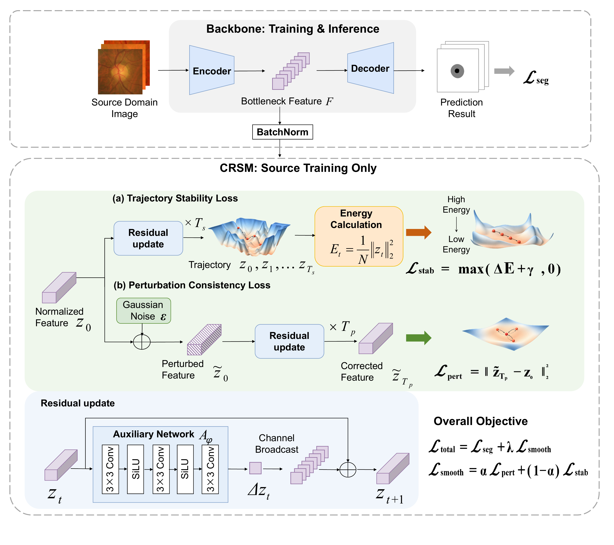

# CRSM

**Cerebellum-inspired Representation Smoothness Method for Domain Generalized Segmentation**  
*International Journal of Neural Systems (IJNS)*

Official PyTorch implementation of CRSM. A training-only auxiliary module encourages smooth bottleneck representations through **Trajectory Stability Loss** and **Perturbation Consistency Loss**. The auxiliary module is omitted at inference, adding no inference overhead.



This release includes OD/OC experiments with ResUNet-18/34/50 and PCSDG+CRSM source training for OD/OC and Polyp. The archived GraTa adaptation and traffic-scene pipelines are not included.

## Installation

Python 3.10+ and a matching PyTorch/torchvision pair are recommended. Install the requirements with:

```bash
pip install -r requirements.txt
```

## Data Preparation

For OD/OC and Polyp, download the preprocessed data from [VPTTA's data folder](https://drive.google.com/drive/folders/1axgu3-65un-wA_1OH-tQIUIEHEDrnS_-?usp=drive_link) and follow the [VPTTA repository](https://github.com/Chen-Ziyang/VPTTA). Pass the directory containing the corresponding CSV files to `--data_root`.

## Training and Evaluation

OD/OC ResUNet example (choose `resunet18`, `resunet34`, or `resunet50`):

```bash
cd OPTIC
python train.py --source_domain B --backbone resunet34 --use_crsm true --seed 0 --data_root /path/to/optic
python test.py --checkpoint runs/resunet34_srcB_crsm_seed0/best_target_mean.pth --data_root /path/to/optic
```

PCSDG+CRSM examples:

```bash
cd ../PCSDG
python train.py --dataset odoc --source_domain A --seed 0 --data_root /path/to/optic --run_id odoc_A_s0_crsm
python eval.py --dataset odoc --checkpoint runs/odoc_A_s0_crsm/final.pth --data_root /path/to/optic
python train.py --dataset polyp --source_domain A --seed 0 --data_root /path/to/polyp --run_id polyp_A_s0_crsm
python eval.py --dataset polyp --checkpoint runs/polyp_A_s0_crsm/final.pth --data_root /path/to/polyp
```

These archived protocols evaluate labeled held-out domains during training for checkpoint selection or early stopping; the release preserves that behavior.

## Acknowledgements

The data conventions follow [VPTTA](https://github.com/Chen-Ziyang/VPTTA). The combined method builds on [PCSDG](https://github.com/HopkinsKwong/PCSDG); its task-specific implementation here does not include files copied from the upstream PCSDG repository. The paper also compares with [GraTa](https://github.com/Chen-Ziyang/GraTa) and [PDAF](https://github.com/pdaf-iccv/PDAF).

## License

This repository is released under the [MIT License](LICENSE). The VPTTA copyright notice is retained in the license file. Datasets and other referenced projects remain under their own terms.
